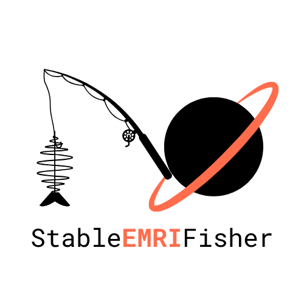

# StableEMRIFisher (SEF)

<table>
<tr>
<td style="width: 220px; vertical-align: middle;">
  
</td>
<td style="vertical-align: middle; padding-left: 20px;">

**StableEMRIFisher** is a Python package for computing stable Fisher information matrices for Extreme Mass Ratio Inspiral (EMRI) gravitational wave sources. It provides robust numerical derivatives of waveforms and returns Fisher matrices that can be used for accelerated parameter estimation analyses or population inference. 

</td>
</tr>
</table>

StableEMRIFisher uses the [FastEMRIWaveforms](https://github.com/BlackHolePerturbationToolkit/FastEMRIWaveforms) package. Please refer to the [documentation](https://stableemrifisher.readthedocs.io) to know how to get started.

## Key Features

- **Stable Numerical Derivatives**: Robust finite difference methods for parameter derivatives for adiabatic Kerr eccentric equatorial based waveform models.
- **Stability Checks**: Careful validation of numerical stability and convergence of the derivatives. 
- **GPU Acceleration**: Efficient computation for both CPUs and GPUs.
- **Response Function** Utilises [fastlisaresponse](https://github.com/mikekatz04/lisa-on-gpu.git) to efficiently compute the response of the LISA detector to EMRI waveforms.
- **Validated**: Compared against MCMC parameter estimation studies.

## Installation

<!-- 
## Quick Install (CPU-only)
```bash
# Install from PyPI (coming soon)
pip install stableemrifisher
```
-->

### Development Installation (Recommended)

If you're using conda 

```bash
# Create and activate environment
conda create -n sef_env python=3.12
conda activate sef_env

# Clone and install
git clone https://github.com/perturber/StableEMRIFisher.git
cd StableEMRIFisher
pip install -e .
```

### GPU-Accelerated Installation

For GPU acceleration, install with CUDA support. **Note**: GPU support requires Linux x86_64 systems with NVIDIA GPUs and appropriate CUDA drivers.

**Using pip:**
```bash
# For CUDA 11.x (Linux x86_64 only)
pip install -e ".[cuda11x]"

# For CUDA 12.x (Linux x86_64 only)  
pip install -e ".[cuda12x]"
```

**StableEMRIFisher with the LISA response**

- First install `lisaanalysistools` by following the instructions [here](https://github.com/mikekatz04/LISAanalysistools.git). If using GPUs, install from source.
- Second install `fastlisaresponse` by following the instructions [here](https://github.com/mikekatz04/lisa-on-gpu.git). If using GPUs, install from source.

## Documentation

**Full documentation is available at [stableemrifisher.readthedocs.io](https://stableemrifisher.readthedocs.io)**

- [Installation Guide](https://stableemrifisher.readthedocs.io/en/latest/installation.html)
- [Quick Start Tutorial](https://stableemrifisher.readthedocs.io/en/latest/quickstart.html)
- [API Reference](https://stableemrifisher.readthedocs.io/en/latest/api/)
- [Examples](https://stableemrifisher.readthedocs.io/en/latest/examples.html)
- [Validation Studies](https://stableemrifisher.readthedocs.io/en/latest/validation.html)

### Building Documentation Locally

```bash
# Install documentation dependencies
pip install -e ".[docs]"

# Build documentation
cd docs
make clean
make html

# View documentation
open _build/html/index.html  # macOS
# or 
xdg-open _build/html/index.html  # Linux
```


## Contributing

We welcome contributions! Please:

1.  **Report bugs** via [GitHub Issues](https://github.com/perturber/StableEMRIFisher/issues)
2.  **Suggest features** through issue discussions
3.  **Submit pull requests** with improvements
4.  **Improve documentation** and examples

## Citation

If you use StableEMRIFisher in your research, please cite it using the metadata in our `CITATION.cff` file.

You can easily copy the citation in APA or BibTeX format by clicking the **"Cite this repository"** button in the right sidebar of this GitHub page. Alternatively, you can use the following BibTeX entry:

```bibtex
@software{Kejriwal_StableEMRIFisher_2026,
  author       = {Kejriwal, Shubham and Burke, Ollie and Chapman-Bird, Christian and J. K. Chua, Alvin},
  title        = {StableEMRIFisher},
  version      = {1.0.0},
  year         = {2026},
  publisher    = {Zenodo},
  doi          = {10.5281/zenodo.18778938},
  note         = {GitHub repository: \url{https://github.com/perturber/StableEMRIFisher}}
}
```

Please also cite [FastEMRIWaveforms](https://github.com/BlackHolePerturbationToolkit/FastEMRIWaveforms) and other dependencies as appropriate.

## License

This project is licensed under the MIT License - see the [LICENSE](LICENSE) file for details.

## Support

- **Questions**: Open a [GitHub Discussion](https://github.com/perturber/StableEMRIFisher/discussions)
- **Bug Reports**: Submit a [GitHub Issue](https://github.com/perturber/StableEMRIFisher/issues)
- **Documentation**: Visit [stableemrifisher.readthedocs.io](https://stableemrifisher.readthedocs.io)

## Acknowledgments

Development supported by:
- Centre National de la Recherche Scientifique (CNRS)
- National University of Singapore

Special thanks to the FastEMRIWaveforms development team and the LISA Consortium.
