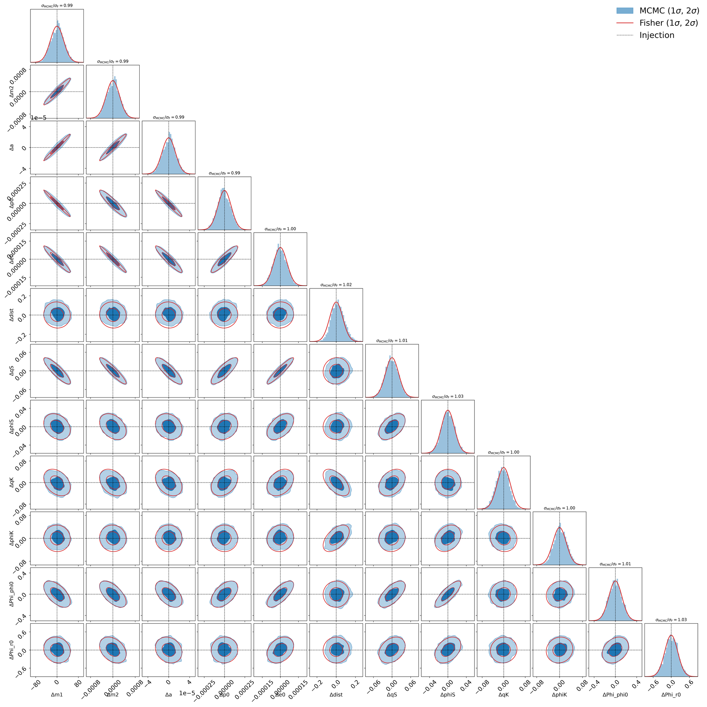
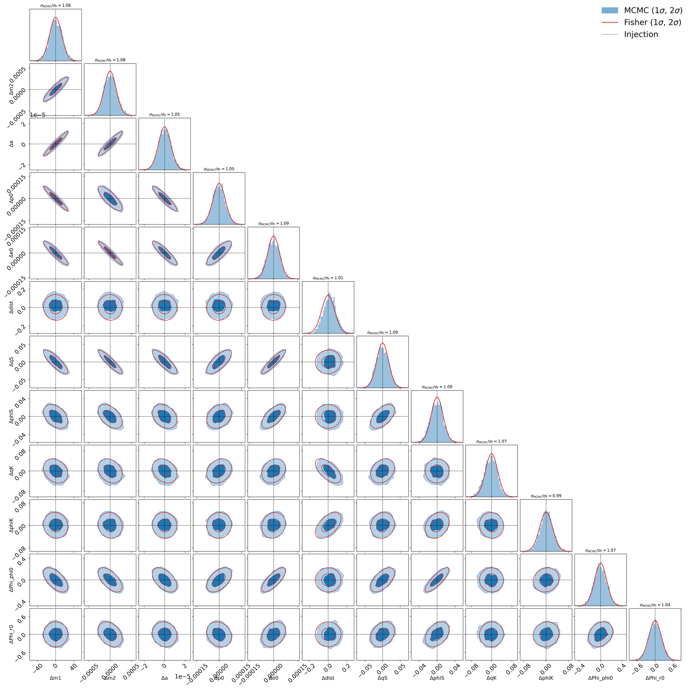
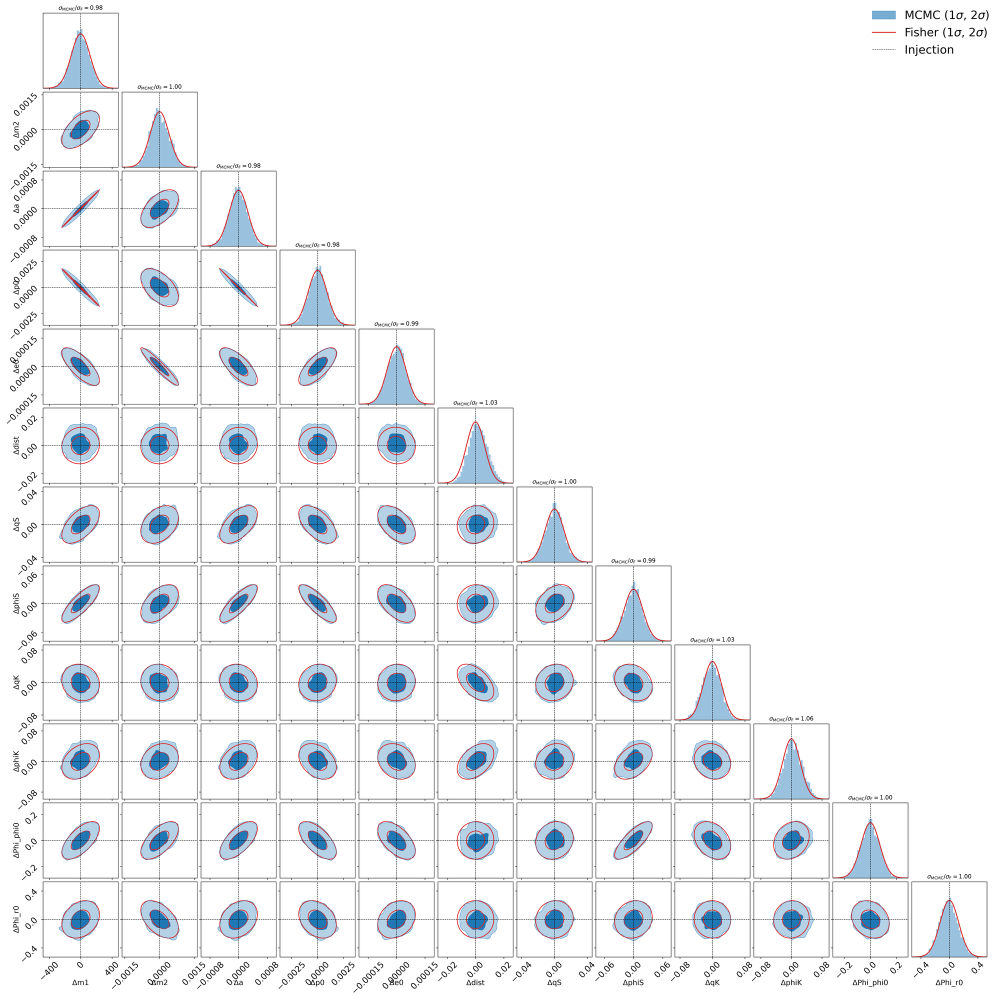
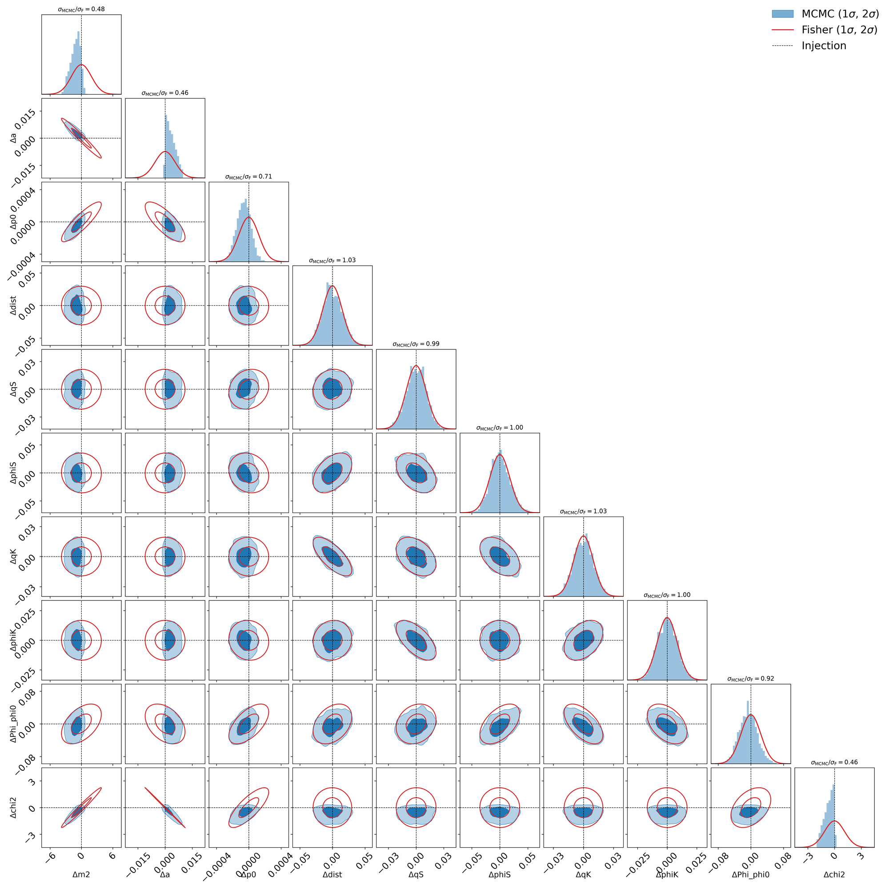
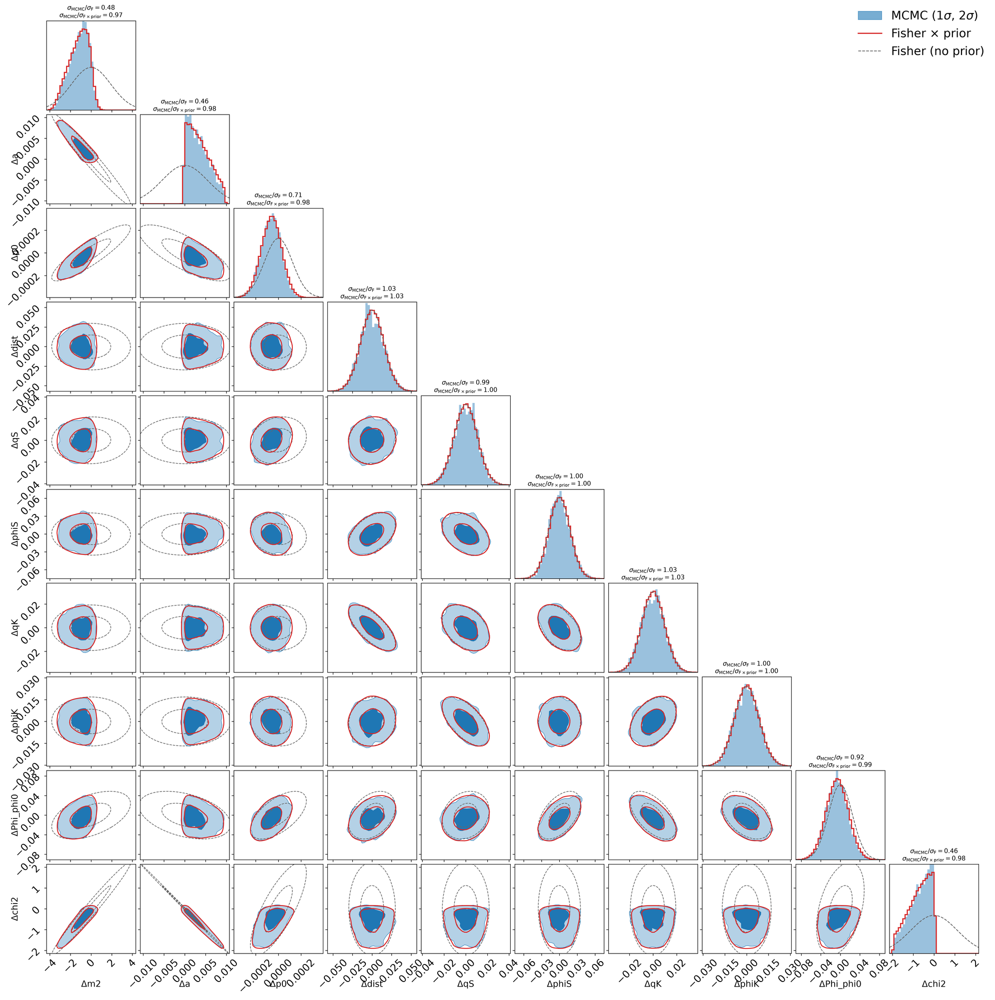

Validation
==========

The Fisher matrix approximates the posterior of a source by a Gaussian. To check how well, StableEMRIFisher's Fisher matrices are compared with full MCMC posteriors of the same sources, for four injections: three Kerr EMRIs (prograde, prograde plunging during the observation, retrograde) and one IMRI with a spinning secondary at first post-adiabatic order.

Set-up
------

Each comparison is made by ``examples/check_against_mcmc/exec.py`` from an injection config in the same folder (see its ``README.md``):

- **Signal:** a noiseless injection through the LISA response (first-generation TDI, A and E channels, equal-arm orbits), with the SciRDv1 noise PSD including the galactic foreground. The initial separation is set by the time to plunge, and the distance by the SNR.
- **Fisher matrix:** StableEMRIFisher with the stable derivative (fourth-order stencil) and its step-size search.
- **MCMC:** the Eryn sampler with parallel tempering (5 temperatures, 24 walkers, 1000 steps), half stretch moves and half Gaussian moves with the Fisher covariance. The likelihood is computed with the same waveform, response and noise as the Fisher matrix. Priors are uniform over :math:`\pm 10` Fisher standard deviations around the injection, clipped to the physical range of the spins where needed.

Metrics
-------

All metrics are computed in coordinates where the Fisher Gaussian, centred on the injection, is a standard normal, so they are dimensionless (``examples/check_against_mcmc/metrics.py``):

- :math:`\sigma_{\rm MCMC} / \sigma_{\rm F}`: ratio of the MCMC and Fisher standard deviations of each parameter.
- bias / :math:`\sigma_{\rm F}`: offset of the MCMC mean from the injection.
- :math:`W_1`: 1-Wasserstein distance between each MCMC marginal and the Fisher Gaussian. It also measures differences in shape.
- Joint KL and :math:`W_2`: KL divergence and 2-Wasserstein distance between a Gaussian with the MCMC mean and covariance and the Fisher Gaussian, over all parameters.
- **Noise floor:** the same metrics for as many independent draws of the Fisher Gaussian as the chain has effective samples. A perfect match gives values at this floor.

Summary
-------

.. list-table::
   :header-rows: 1
   :widths: 34 14 12 12 28

   * - Injection
     - Joint KL
     - Joint :math:`W_2`
     - Largest :math:`W_1`
     - Intrinsic :math:`\sigma_{\rm MCMC} / \sigma_{\rm F}`
   * - Kerr, prograde
     - 0.11
     - 0.43
     - 0.32 (dist)
     - 0.99 to 1.00
   * - Kerr, prograde, plunging
     - 0.17
     - 0.49
     - 0.31 (dist)
     - 1.06 to 1.10
   * - Kerr, retrograde
     - 0.19
     - 0.59
     - 0.33 (dist)
     - 0.98 to 1.01
   * - Circ1PAT1R IMRI, Fisher only
     - 0.89
     - 1.01
     - 0.67 (chi2)
     - 0.46 to 0.71
   * - Circ1PAT1R IMRI, Fisher times prior
     -
     -
     -
     - 0.97 to 0.98

The noise floors (95th percentile) are about 0.02 to 0.03 for the joint KL, 0.16 to 0.18 for the joint :math:`W_2` and 0.04 to 0.05 for :math:`W_1`.

In all three Kerr runs the Fisher matrix reproduces the posterior widths and correlations, within 1% for the two non-plunging sources and within 4 to 10% for the plunging one. The joint metrics are above the noise floor mainly because of the luminosity distance, which is not a failure of the Fisher matrix: its posterior is skewed towards larger distances, through its correlation with the orientation of the binary (qK, phiK), so its mean lies about 0.3 Fisher standard deviations above the injection, while the likelihood peaks exactly at the injection. A Gaussian cannot have this skew. In the Circ1PAT1R run the prior on the secondary spin shapes the posterior, and the Fisher Gaussian has to be multiplied by it to be compared with the MCMC (see below).

In the corner plots, the MCMC posterior is filled (:math:`1\sigma` and :math:`2\sigma`), the Fisher Gaussian is drawn in red, and each axis shows the offset from the injection.

Kerr EMRI, prograde
-------------------

``FastKerrEccentricEquatorialFlux``: :math:`m_1 = 10^6\,M_\odot`, :math:`m_2 = 10\,M_\odot`, :math:`a = 0.9`, :math:`e_0 = 0.1`, equatorial prograde orbit, plunging 0.01 yr after the end of a 1-yr observation, SNR 50.

.. literalinclude:: kerr_prograde_nonplunging_withresponse/metrics.txt
   :language: none

Kerr EMRI, prograde, plunging
-----------------------------

The same source, plunging 0.01 yr before the end of the observation. The observation is cut 6 hours before the plunge.

.. literalinclude:: kerr_prograde_plunging_withresponse/metrics.txt
   :language: none

The intrinsic parameters are 6 to 10% wider in the MCMC than in the Fisher matrix; otherwise the match is as close as for the source that plunges after the observation.

Kerr EMRI, retrograde
---------------------

As the prograde source, with :math:`a = -0.9`.

.. literalinclude:: kerr_retrograde_nonplunging_withresponse/metrics.txt
   :language: none

Circ1PAT1R IMRI with a spinning secondary
-----------------------------------------

``Circ1PAT1R`` (circular orbit, first post-adiabatic order): :math:`m_1 = 10^6\,M_\odot` (held fixed), :math:`m_2 = 10^4\,M_\odot`, :math:`a = 0.9`, secondary spin :math:`\chi_2 = 0.95`, plunging 0.001 yr after the end of a 0.1-yr observation, SNR 200. The priors on :math:`a` and :math:`\chi_2` are limited to the model's valid range :math:`[-1, 1]`.

.. literalinclude:: circ1pat1r_imri_nonplunging_withresponse/metrics.txt
   :language: none

Here the Fisher Gaussian alone does not describe the posterior: the MCMC is about half as wide in :math:`m_2`, :math:`a` and :math:`\chi_2`, and offset from the injection. The secondary spin is weakly constrained, with a Fisher standard deviation of about 1.2, larger than its whole valid range, and the injection, 0.95, is only 0.05 from the prior's upper bound. The posterior is the likelihood times the prior, and the prior cuts away almost the whole upper half of the likelihood in :math:`\chi_2`. Because :math:`\chi_2` is almost perfectly correlated with :math:`a` and strongly with :math:`m_2` and :math:`p_0`, the cut also narrows and shifts those parameters.

The Fisher matrix approximates the likelihood, not the posterior. The consistent comparison is therefore with the Fisher Gaussian times the same uniform prior as in the MCMC, a truncated Gaussian (``examples/check_against_mcmc/fisher_prior.py``):

The Fisher Gaussian times the prior (red) reproduces the MCMC posterior, including the one-sided :math:`a` and :math:`\chi_2` marginals and the clipped two-dimensional contours, with widths within 3% of the MCMC for every parameter (:math:`\sigma_{\rm MCMC} / \sigma_{\rm F \times prior}` = 0.97 to 0.98 for :math:`m_2`, :math:`a`, :math:`p_0` and :math:`\chi_2`), while the Fisher Gaussian without the prior (dashed) is about twice as wide.

Running the comparison
----------------------

From ``examples/check_against_mcmc``, on a GPU:

.. code-block:: bash

   python exec.py injection_config_kerr_prograde_nonplunging_withresponse.py   # Fisher matrix and MCMC
   python metrics.py                                                           # metrics.txt for every run
   python fisher_prior.py <run folder>/<tag>.h5                                # Fisher x prior corner plot

``python exec.py <injection_config>.py --fisher-only`` recomputes the Fisher matrix of a finished run, keeping its chains.
